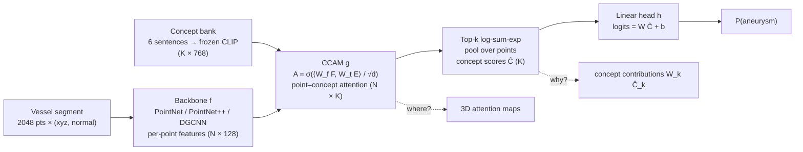
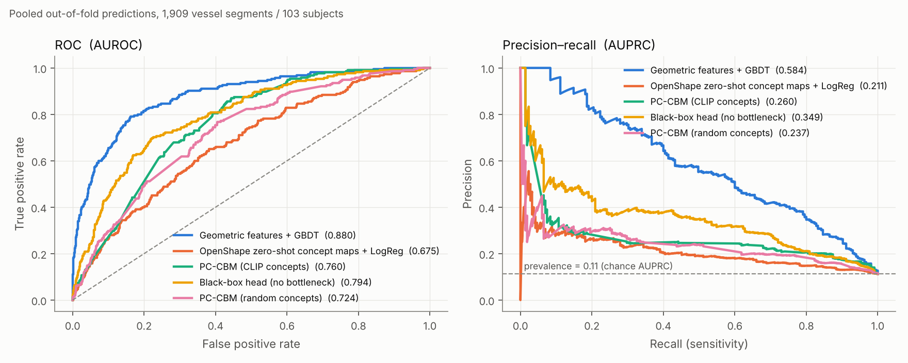
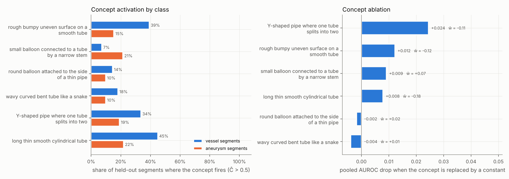
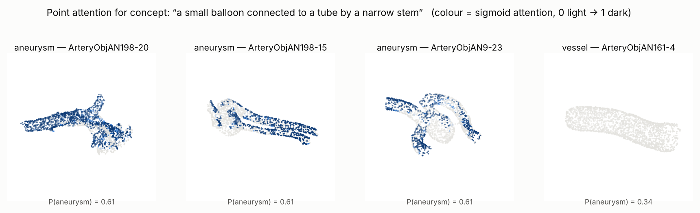
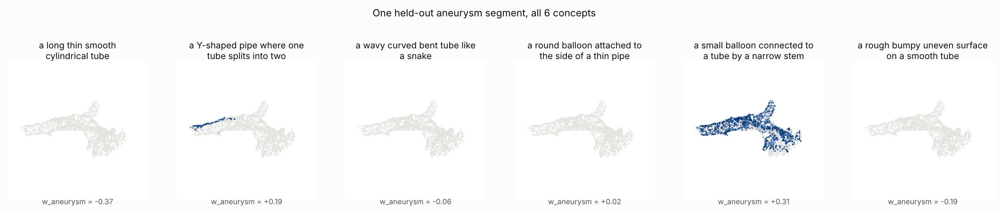

# PointCBM — Interpretable Intracranial-Aneurysm Detection from 3D Point Clouds

[](https://github.com/xiaoxurong/interpretable-aneurysm-detection/actions/workflows/ci.yml)


**PC-CBM** is a concept bottleneck model for 3D point clouds. It classifies
segments of brain vessels as *healthy vessel* or *aneurysm*. Every prediction is
a linear function of a few plain-language concepts (e.g. *"a small balloon
connected to a tube by a narrow stem"*), and each concept score can be traced to
the 3D points that produced it.

> **At a glance**
> - **Task:** binary classification on [IntrA](https://github.com/intra3d2019/IntrA): 1,909 vessel segments, 103 subjects, 11% aneurysm.
> - **Model:** point-cloud backbone (PointNet / PointNet++ / DGCNN) → cross-attention between points and CLIP text embeddings of concepts → linear classifier on concept scores.
> - **Results:** the best PC-CBM (PointNet++ + SupCon) reaches **0.876 ± 0.032 AUROC** in subject-grouped 5-fold CV. That matches a strong hand-crafted geometric baseline (0.880) and also explains each prediction through concepts. Controlled ablations measure what the bottleneck costs and what the language grounding adds.
> - **Rigor:** subject-level splits (verified by tests), thresholds chosen on validation only, subject-bootstrap CIs, a strong non-deep baseline, and black-box / random-concept controls.
> - **Engineering:** installable package, backbone registry, YAML configs with CLI overrides, 31 unit tests + CI, ONNX export with parity check, CPU latency profile.

---

## Contents
[Method](#method) · [Results](#results) · [What I learned](#what-i-learned) · [Quickstart](#quickstart) · [Repository layout](#repository-layout) · [Limitations & next steps](#limitations--next-steps)

## Method



**Training objective** (`pointcbm/losses.py`)

$$\mathcal L = \underbrace{\text{Focal}(y,\hat y)}_{\text{imbalance}} + \lambda_s\,\underbrace{H(A)}_{\text{localised maps}} + \lambda_o\,\underbrace{\overline{|\cos(A_i, A_j)|}}_{\text{distinct concepts}} + \lambda_c\,\underbrace{\text{SupCon}(\hat C)}_{\text{class-structured concept space}} + \lambda_1\lVert W\rVert_1$$

The design choices (sigmoid instead of softmax attention, top-k LSE pooling, and
why the head is kept strictly linear) are explained in [`docs/DESIGN.md`](docs/DESIGN.md).

## Results

All numbers use the **same subject-grouped 5-fold splits** (no subject appears in
more than one of train / val / test). The decision threshold is chosen on each
fold's validation split, and the test fold is scored once.

### 1. Full-size backbones (GPU runs, original project)

| Backbone | Loss | ACC₀ (vessel) | ACC₁ (aneurysm) | AUROC | Macro-F1 |
|---|---|---|---|---|---|
| PointNet++ | Focal | 0.530 ± 0.234 | 0.853 ± 0.163 | 0.827 ± 0.107 | 0.483 ± 0.143 |
| **PointNet++** | **Focal + SupCon** | **0.877 ± 0.014** | 0.733 ± 0.133 | **0.876 ± 0.032** | **0.726 ± 0.029** |
| DGCNN | Focal | 0.559 ± 0.288 | 0.659 ± 0.334 | 0.699 ± 0.046 | 0.455 ± 0.099 |
| DGCNN | Focal + SupCon | 0.278 ± 0.250 | **0.930 ± 0.095** | 0.786 ± 0.033 | 0.313 ± 0.181 |
| PointNet | Focal | 0.584 ± 0.215 | 0.672 ± 0.220 | 0.687 ± 0.083 | 0.482 ± 0.101 |
| PointNet | Focal + SupCon | 0.280 ± 0.395 | 0.833 ± 0.236 | 0.642 ± 0.111 | 0.277 ± 0.238 |

These numbers come from the original evaluation script. It used a fixed 0.5
threshold (argmax), which explains the large ACC₀/ACC₁ swings in some rows: on
some folds the classifier sits close to a single-class solution. That script could
also drop such folds from the mean. AUROC does not depend on the threshold.
`experiments/run_gpu_table.sh` re-runs all six rows under the revised protocol
(validation-selected threshold, every fold counted).

### 2. Baselines and controlled ablations (CPU-reproducible)

To isolate *what matters*, every comparison below changes **one factor at a time**.
All runs share the same compact backbone (`PointNetLite`, 512 points), seed and
schedule (`configs/cpu_ablation.yaml`). The whole suite reruns in about an hour on a
2-core laptop CPU.

| Model | AUROC (pooled, 95% CI) | AUROC (fold mean ± std) | AUPRC | Bal. acc | Spec. (ACC₀) | Sens. (ACC₁) | Macro-F1 | ECE |
|---|---|---|---|---|---|---|---|---|
| Geometric features + GBDT | **0.880** (0.847–0.908) | 0.883 ± 0.034 | 0.593 ± 0.082 | 0.801 ± 0.043 | 0.806 ± 0.061 | 0.795 ± 0.108 | 0.681 ± 0.050 | 0.058 ± 0.010 |
| Geometric features + LogReg | **0.878** (0.841–0.910) | 0.880 ± 0.039 | 0.542 ± 0.110 | 0.798 ± 0.035 | 0.783 ± 0.034 | 0.813 ± 0.058 | 0.664 ± 0.029 | 0.190 ± 0.016 |
| OpenShape zero-shot concept maps + LogReg | **0.675** (0.635–0.712) | 0.676 ± 0.036 | 0.233 ± 0.059 | 0.615 ± 0.037 | 0.606 ± 0.098 | 0.624 ± 0.099 | 0.497 ± 0.046 | 0.260 ± 0.022 |
| PC-CBM (CLIP concepts) | **0.760** (0.706–0.810) | 0.761 ± 0.059 | 0.260 ± 0.076 | 0.706 ± 0.036 | 0.679 ± 0.082 | 0.732 ± 0.091 | 0.569 ± 0.047 | 0.329 ± 0.002 |
| Black-box head (no bottleneck) | **0.794** (0.744–0.838) | 0.811 ± 0.039 | 0.404 ± 0.058 | 0.736 ± 0.037 | 0.777 ± 0.106 | 0.695 ± 0.171 | 0.630 ± 0.044 | 0.168 ± 0.076 |
| PC-CBM (random concepts) | **0.724** (0.684–0.765) | 0.742 ± 0.022 | 0.259 ± 0.049 | 0.663 ± 0.026 | 0.780 ± 0.080 | 0.545 ± 0.126 | 0.590 ± 0.025 | 0.341 ± 0.033 |
| PC-CBM (no SupCon) | **0.768** (0.725–0.808) | 0.763 ± 0.047 | 0.264 ± 0.047 | 0.733 ± 0.034 | 0.617 ± 0.066 | 0.849 ± 0.081 | 0.551 ± 0.031 | 0.345 ± 0.008 |

<p align="center"></p>

**What the controls show**

| Question | Comparison | Answer |
|---|---|---|
| Does deep learning beat simple geometry here? | Geometric + GBDT vs. every compact deep model | **No, not at this scale.** 44 interpretable shape descriptors (tube-radius profile, curvature, PCA shape) reach 0.88 AUROC. The full-size PointNet++ PC-CBM only *matches* this. |
| Does a frozen 3D foundation model already know aneurysms? | OpenShape zero-shot concept maps | **Barely** (0.68 AUROC). Medical vessel geometry is out of distribution for a model trained on ShapeNet/Objaverse. This is why the bottleneck is trained end-to-end. |
| What does the bottleneck cost? | PC-CBM vs. black-box head, same backbone | **~0.03–0.05 AUROC** (0.76 vs. 0.79 pooled; the CIs overlap) and a large AUPRC gap (0.26 vs. 0.40). Restricting the decision to 6 scalar concepts discards information. |
| Does CLIP grounding matter, or are concepts just prototypes? | CLIP bank vs. random unit vectors | **Small, not significant gain** (0.76 vs. 0.72 pooled, overlapping CIs). Most of the accuracy comes from the bottleneck structure. The concept *names* need separate validation (see §3). |
| Does SupCon help? | λ_SupCon = 0.01 vs. 0 | **Not for the compact backbone** (0.76 vs. 0.77). It helped PointNet++ in Table 1 (0.83 → 0.88), so the effect depends on the backbone. |

*Pooled AUROC: all out-of-fold predictions together; the 95% CI comes from a bootstrap that resamples subjects. Other columns: mean ± std over the 5 test folds. ACC₀/ACC₁/F1 use the validation-selected threshold.*

### 3. Interpretability: which concepts drive the decision?

<p align="center"></p>

The head is linear, so dropping a concept is exact: replace its score with a
constant and recompute the prediction. **Left:** how often each concept fires on
held-out segments, by class. **Right:** how much pooled AUROC falls when each concept is ablated.

* The concept whose text describes an aneurysm, *"a small balloon connected to a
  tube by a narrow stem"*, fires on **21% of aneurysm segments vs. 7% of vessel
  segments**. It is also the only concept with a clearly positive aneurysm weight.
* The healthy-vessel concepts (*smooth cylindrical tube*, *Y-shaped split*,
  *rough surface*) fire about 2–2.5× more often on vessels. The model largely detects
  aneurysms by the **absence of normal-vessel evidence**.
* Ablating any single concept costs at most 0.024 AUROC. The concepts are
  partly redundant, so no single one is a point of failure.

<details>
<summary><b>3D attention maps</b> (click to expand)</summary>

<p align="center"></p>
<p align="center"></p>

**Reading the maps:** the "small balloon" concept is silent on the healthy vessel and
active on the aneurysm segments. But on segments like `AN9-23` the strongest attention
falls on the parent vessel rather than the sac itself. At this model size the
concept works as a reliable *segment-level* detector, **not yet a localiser**.
Point-level supervision (IntrA ships aneurysm segmentation masks) or the OpenShape
pseudo-label alignment term (`lambda_align`) is the obvious next step. See
[Limitations](#limitations--next-steps).
</details>

### 4. Deployment profile (CPU, N = 2048 points)

| Backbone (+ CBM head) | Params | Weights | PyTorch, batch 1 | PyTorch, batch 32 | ONNX Runtime, batch 1 | ONNX vs. PyTorch max \|Δ\| |
|---|---|---|---|---|---|---|
| PointNetLite | 0.33 M | 1.3 MB | 7 ms | 137 segments/s | 6 ms | 6e-08 |
| PointNet | 3.18 M | 12.1 MB | 22 ms | 21 segments/s | 16 ms | 1e-07 |
| DGCNN | 0.27 M | 1.0 MB | 146 ms | 4 segments/s | 56 ms | 1e-07 |
| PointNetPlusPlus | 1.03 M | 3.9 MB | 76 ms | 10 segments/s | 104 ms | 0e+00 |

*Measured with `scripts/benchmark_inference.py` on a 2-thread cloud CPU, torch 2.15.0, onnxruntime, median of 15 runs. PointNet++ and DGCNN are bottlenecked by farthest-point sampling (a sequential loop) and k-NN graph construction rather than by matrix multiplies, so they gain the most from a GPU or custom CUDA ops.*

The deployed graph has the frozen concept bank baked in. It takes only the points
and returns `P(aneurysm)` plus the six concept scores, so the explanation travels
with the prediction.

## What I learned

1. **Baselines first.** A one-minute gradient-boosting model on 44 geometric
   descriptors matches my best deep model. Without it I would have
   over-claimed. Interpretability, not accuracy, is the contribution here.
2. **Group-aware evaluation matters more than model choice on small medical data.**
   Splitting by subject, choosing thresholds on validation only, and running a
   cluster bootstrap moved the conclusions more than any architecture change.
3. **Concept bottlenecks need controls.** Without the random-embedding control,
   the CLIP concept names look like the model's reasoning. With it, most of the
   accuracy comes from the bottleneck, and concept semantics have to be checked
   separately (activation by class, ablations, attention maps).
4. **Optimisation dynamics differ.** The bottleneck's validation AUROC swings
   by ±0.1 in early epochs, while the black-box head's is smooth. Early stopping
   with short patience killed CBM runs at epoch 2–4, so a warm-up period before
   early stopping is required for a fair comparison.

## Quickstart

```bash
git clone https://github.com/xiaoxurong/interpretable-aneurysm-detection.git && cd interpretable-aneurysm-detection
pip install -e ".[dev,deploy]"      # CPU wheels are fine for everything below except the GPU table
make test                           # 31 unit tests (a few seconds)
make smoke                          # 1 fold × 1 epoch, end to end
```

| Goal | Command |
|---|---|
| Train PC-CBM (5-fold CV) | `python scripts/train.py --config configs/train_intra.yaml` |
| Swap backbone / loss from the CLI | `... --set model.backbone=DGCNN loss_weights.lambda_supcon=0` |
| Black-box or random-concept control | `... --set model.head=blackbox` · `... --set data.concept_embeddings=random` |
| Evaluate a run (config read from the checkpoint) | `python scripts/evaluate.py --checkpoint_dir checkpoints/<run>` |
| Non-deep baselines | `make baselines` |
| CPU ablation suite → tables & figures | `make ablations && make figures` |
| Latency + ONNX export | `make benchmark` |
| Re-encode the concept bank with CLIP | `python scripts/concept_embeddings.py --model ViT-L/14` |
| OpenShape logit-lens analysis | `python scripts/logit_lens.py --help` |

Each training run writes its per-fold checkpoints (with config, concept names and
threshold), per-epoch history, `oof_predictions.csv` and `summary.json`.
Weights & Biases logging is optional: `--set logging.wandb=true`.

## Repository layout

```
pointcbm/                  installable package
├── backbones/             PointNet, PointNetLite, PointNet++, DGCNN + registry
├── models.py              CCAM, ConceptBottleneck3D, BlackBoxClassifier, build_model
├── losses.py              focal, entropy-sparsity, orthogonality, SupCon, alignment
├── data.py                IntrA dataset, augmentation, balanced sampler, subject ids
├── engine.py              train / early-stop / threshold / predict loop for one fold
├── metrics.py             imbalanced-binary metrics, ECE, subject-level bootstrap CI
├── geometry.py            hand-crafted shape descriptors (baseline)
└── config.py              YAML + dotted CLI overrides, seeding, device selection
scripts/                   train · evaluate · baselines · analysis · visualisation · benchmark · logit lens
configs/                   train_intra.yaml (GPU) · cpu_ablation.yaml · evaluate_intra.yaml
experiments/               shell scripts that reproduce every table
results/                   summaries, out-of-fold predictions, the PC-CBM ablation checkpoints
tests/                     model contracts, losses, metrics, split leakage, config
docs/                      DESIGN.md (decisions + bug log), figures/
data/                      processed IntrA point clouds, subject-grouped folds, concept bank, OpenShape maps
```

## Limitations & next steps

* **Localisation is not yet faithful.** Attention maps separate classes but do not
  consistently highlight the sac. Next: score maps against IntrA's
  point-level aneurysm annotations (pointing game / IoU), and train with
  `lambda_align` on the OpenShape pseudo-labels.
* **Probabilities are miscalibrated** (ECE ≈ 0.33 for the CBM) because of
  balanced sampling plus focal loss. Next: temperature or Platt scaling fitted on
  the validation split.
* **Small cohort.** 103 subjects (38 with an aneurysm), and the CIs overlap for
  most compact-model comparisons. Rankings among the deep variants should be read
  as tendencies.
* **A hybrid is the obvious next model.** Add the geometric descriptors as extra
  *named* concepts in the bottleneck. They are interpretable and strongly predictive.
* The compact ablations use 512 points and `PointNetLite` so that they run on a CPU.
  The full-size table uses 2,048 points and GPU training.

## Acknowledgements

Started as a graduate course project at UW–Madison and later extended into this
repository. Data: **IntrA** (Yang et al., *IntrA: 3D Intracranial Aneurysm Dataset
for Deep Learning*, CVPR 2020). Concept text encoder: **CLIP** (Radford et al., 2021).
Zero-shot 3D concept maps: **OpenShape** (Liu et al., NeurIPS 2023). Backbones:
PointNet / PointNet++ (Qi et al., 2017), DGCNN (Wang et al., 2019). Concept bottleneck
models: Koh et al., ICML 2020.
